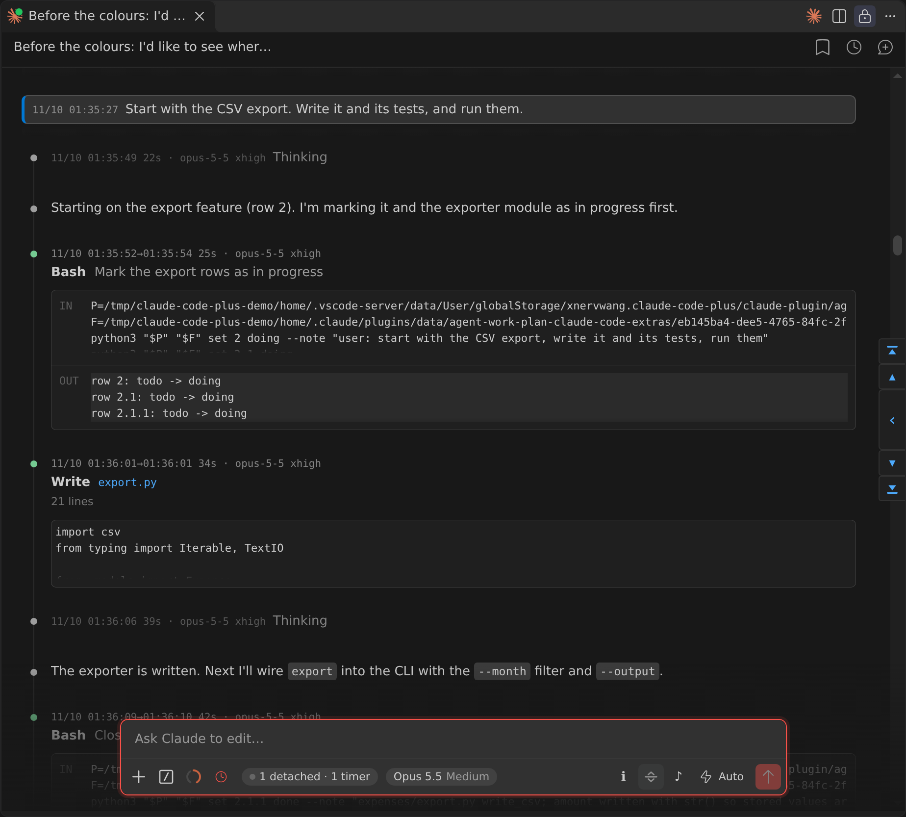
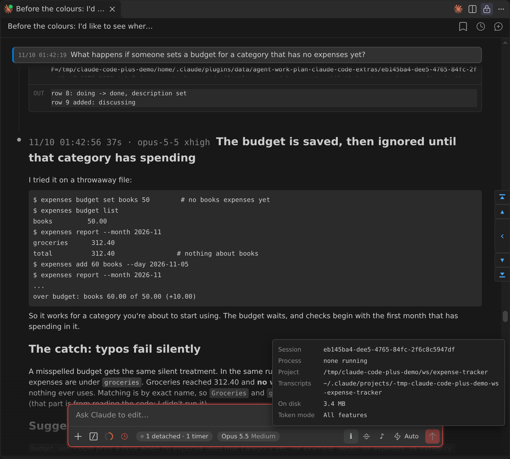
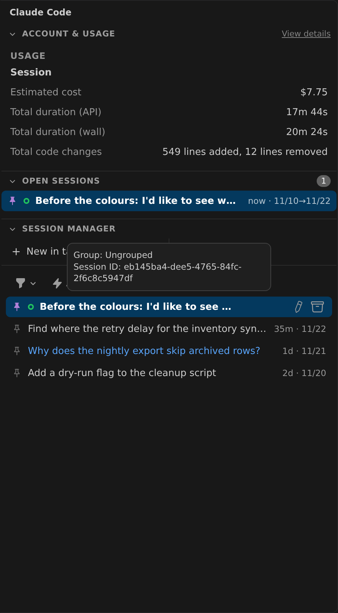

# Claude Code Plus

Claude Code Plus gives Claude a work plan, so that Claude does not lose track of unfinished work when you switch topics before the work is done, or when compaction summarizes older turns. Claude starts a plan when there is work to track and updates it as you talk. Each piece of work is a numbered row in the plan.

The plan is stored in a file outside the conversation, and Claude gets its open rows every turn. Agent Plus, a separate extension installed along with this one, shows the plan in a view beside the Claude Code panel.

Agent Plus's Conversations tab in the VS Code panel lists running Claude Code conversations in this window's workspace folders. Stopped conversations also appear if their plan still has open rows and was written in the last 7 days. A row that waits for your answer carries a question; the question appears under its conversation, and an answer entered in the Answer view next to the Conversations tab goes into that conversation's message input.

Claude Code Plus also adds message timestamps and reply details (duration, context share, cost and model), session-list controls (open sessions, pins, text colors and deletion of archived conversations), and views of background sessions, scheduled prompts and commands a conversation left running outside Claude Code; see [Other features](#other-features). Status dots on tabs and in the session list show whether a conversation is working, has only background work left or is waiting for you. An envelope appears while a reply is unread. With [Steward](#steward), one conversation passes your messages to others and tells you when they need you.

Requires Anthropic's Claude Code extension, Agent Plus and VS Code 1.96 or later. The work plan also needs Python 3.7 or later. On Windows without Python, the extension offers to download it from python.org (11 MB).

## What it looks like

The work plan on the left of the Claude Code panel:


## Work plan

Claude starts a plan when you bring up work it should track, or when you ask for one.

If a conversation runs long without a plan, Claude gets a one-time suggestion to start one (see [Settings](#settings) for what counts as long).

### Row numbers

Rows have numbers such as 1, 2 and 2.1. You can answer several rows in one message, in any order:

```text
2.1: not now
3: go ahead
```

A row's number is its position in the plan file, so it does not change: finishing row 2 leaves a gap instead of renumbering the rows after it. A child row such as 2.1 is work that has to be done before its parent can be finished.

### States

| State | Meaning |
| --- | --- |
| `discussing` | Raised, not agreed yet. |
| `todo` | Agreed, not started. |
| `doing` | Being worked on now. |
| `waiting` | Started, but held up by something outside the conversation, such as you, a build or CI run, a reviewer or another conversation. |
| `parked` | Left for later, with the reason; still open. |
| `done` | Finished. |
| `dropped` | Decided against, with the reason. |

Work you ask Claude to do now goes straight to `doing`. Work Claude suggests on its own starts as `discussing` and becomes `todo` only when you agree.


### How Claude gets the plan

The extension registers a Claude Code plugin whose hooks hand the plan to Claude on each turn and around compactions. Its skill holds the rules Claude follows to keep the plan up to date.

- The plugin's skill description loads in every session at about 110 tokens.
- With a plan, every turn carries its open rows: the whole block, with the instructions, on the first turn and the first after each compaction; a short head (the open rows under a shorter header instead of the instructions) when a row has changed; one line when none has. Rows that are `doing` and questions to you carry their notes; other rows show their title only. A finished row can be included when a row under it is still open. The block is cut to fit 6,000 characters, and a last line says how many open rows were left out. See [What it costs in tokens](#what-it-costs-in-tokens).
- Before an automatic compaction, Claude is asked to bring the rows it is working on up to date. After compaction, it is asked to read the plan file before anything else.

### Where the plan lives

Each conversation has one file, named by session ID, under `~/.claude/plugins/data/agent-work-plan-claude-code-extras/`.

Claude writes the file through a small command shipped with the plugin. To correct a plan by hand, open its file from the view's title-bar button or a row's context menu.

See [How the work plan works](docs/how-the-work-plan-works.md) for the hooks, thresholds and measurements.

## Install

Search for **Claude Code Plus** in the Extensions view, or run
`code --install-extension xnervwang.claude-code-plus`. Anthropic's Claude Code extension and
Agent Plus install as dependencies.

If you have Work Plan for Claude Code (`xnervwang.claude-code-extras`), update it to its last version, which installs Claude Code Plus (`xnervwang.claude-code-plus`); you can then uninstall the old extension. While an earlier version of the old extension is installed, Claude Code Plus does nothing except show a warning when you run a command, because both extensions would patch the same Claude Code files. If you uninstall an earlier version of the old extension, VS Code runs its uninstall step on the next start: it copies plans to `~/.claude/agent-work-plan-plans-<time>/`, then unregisters the plugin. Within half a minute, Claude Code Plus registers the plugin again and copies the plans back. On its first start, Claude Code Plus copies `claudeCodeWorkPlan.*` and `claudeCodeExtras.*` settings to `claudeCodePlus.*`, except those kept in a remote machine's own settings file, which you rename by hand. On each start, Claude Code Plus copies pins and text colors from the old extension's storage unless it already has its own. Install Claude Code Plus before uninstalling the old extension, since VS Code deletes that storage when it finishes removing the old extension at its next start.

The extension works by editing files inside the installed Claude Code extension. Reload the
VS Code window twice after installing. Run `Claude Code Plus: Show Status` for the patch
status. In a Remote SSH window, install on the remote.

Verified against Claude Code 2.1.328, 2.1.329 and 2.1.330.

## Other features

### In a conversation

| Feature | What it shows |
| --- | --- |
| Timestamps | Times from the transcript on every message and reply block, and `start→result` on tool calls. Claude Code's own message times are hidden while these are on. |
| Your time zone for Claude | When Claude runs on a machine in another time zone, as with Remote SSH, it is told yours, so it gives you times in your zone. |
| Images in replies | An image Claude gives by absolute path or `file://` address (PNG, JPEG, GIF, WebP or SVG, up to 8 MB) and a `data:` image are drawn in the reply, at most 640 by 480 pixels; click one drawn smaller than its own size to see it as large as the panel allows. An image at a web address stays a link. Claude is told how to give one: save it in the conversation's own folder, and download an image from the web there first. `claudeCodePlus.show.replyImages` turns both off. |
| Reply figures | `2m10s · ctx 33% · cost $0.42 · opus-5 high` on each reply shows turn duration, how much of the context window is in use, the conversation's cost so far, model and effort. |
| Sub-agent tags and filters | Each sub-agent's messages are tagged with its task, such as `#look up tomorrow's weather`. A filter in the footer shows only the main thread or one sub-agent. |
| Conversation navigation | A handle at the right edge of the panel opens a list of your messages by time and first words, with the compaction points marked. Filter the list, click a row to scroll there, step with the arrows or `,` and `.`, or jump to the top or bottom. |
| Focus view button | A footer button that turns Claude Code's own Focus view on and off. While Focus view is on and Claude works, the working line shows the latest tool call and how long it has run, such as `Bash running for 2m55s (since 11:11:18)`. |
| Context meter | The panel's context meter stays visible and gets an outline when 15% of the window remains. Rest the pointer on it for two seconds for a breakdown by category, memory files and custom agents, with what the work plan has added to the context. |
| Chimes | A short sound when a turn finishes, permission is requested or Claude asks a question, played on the machine showing the panel. Mute it in the footer. |
| Session information | A footer button that shows the session ID, Claude's process ID, starting directory, transcript location and size, and the token mode. Click a value to copy it. |
| Token mode | Agent Plus's `agentPlus.tokenMode`, set from its entry in the status bar, decides which of the work plan, the time-zone note and the conversation brief (a summary, and a status saying where the conversation stands; see [Settings](#settings)) are added to Claude's context. Each one's own setting applies only in Custom. See [What it costs in tokens](#what-it-costs-in-tokens). |






### In the session list

| Feature | What it shows |
| --- | --- |
| Open sessions | A section at the top of the session list shows the conversations open in this window, in an editor tab or in the sidebar while it is shown, most recently active first. Each row shows its status dot and, while a reply is unread, an envelope; click the row to switch to the conversation. |
| Open in a tab or the sidebar | **New in tab** and **New in sidebar** replace the New session button. |
| Section and session ID on hover | Hovering over a conversation shows its session ID and where it sits in the list below Open sessions: its group, Ungrouped or Archived sessions. Rows in Open sessions show the same. |
| Search by session ID | The search box also finds a conversation by part of its session ID, such as `69f9`: four or more characters, using only 0-9, a-f and hyphens. Shorter searches, and ones with other characters, match titles and branches only. |
| RECENTLY CLOSED | A section directly above Open sessions with the conversations whose Claude Code editor tabs you closed in this workspace, most recently closed first. Click one to open it again. |
| Session dates | Adds the dates of the first and last messages after Claude Code's last-active time: `11d` becomes `11d · 09/05→09/16`. |
| Pinned conversations | Click the pin at the start of a session-list row to keep that conversation from Claude Code's transcript cleanup (`cleanupPeriodDays`) and out of Archived sessions. |
| Text colors | Right-click a conversation and choose **Text color** to give its title one of the colors of Claude Code's `/color`. The color shows wherever the conversation is listed. |
| Delete archived conversations | **Delete session…** in an archived conversation's right-click menu permanently deletes it from disk once you confirm. You cannot delete a conversation that is running or open in any VS Code window on the same machine. This includes a tab that VS Code restored after a window reload but has not yet loaded. Claude Code Plus then names the window that has it open. |
| Background sessions left out | The list skips sessions started with `claude --bg` or `claude -p`, and empty transcripts. Turn off `claudeCodePlus.hideBackgroundSessions` to see them. |



#### Opening in a tab or the sidebar

A closed conversation's right-click menu offers **Resume in tab** and **Resume in sidebar** instead of Resume session; an open one keeps Switch to session. These do not change `claudeCode.preferredLocation`; the Claude button at the right of the editor tabs still opens where that setting says.

#### Recently closed

The section starts collapsed, and the list is kept across reloads. Open conversations are not listed, and up to `claudeCodePlus.recentClosedSessions` conversations are shown (10 by default).

#### Pinned conversations

To protect a pinned conversation, the extension moves its files' modification time forward once they are old enough for the cleanup. The row still shows when the conversation was last active, but the list sorts it by the moved time. Uninstalling the extension removes the pins; the conversations stay, and the cleanup treats them as usual again.

Pins are kept on the machine that holds the transcripts. A pin protects a conversation only while some VS Code window with this extension connects to the machine that holds its transcript, and stays open for at least a minute, at least once every `claudeCodePlus.sessionPinsMarginDays` days (14 by default, and never more than half of `cleanupPeriodDays`). The folder the window has open does not matter: each window refreshes every pinned conversation on that machine a minute after it starts and every 30 minutes while it stays open. After a longer gap, Claude Code's cleanup can delete pinned conversations the next time Claude Code runs on that machine, in a terminal or as a background session.

#### Deleting archived conversations

Deleting an archived conversation removes its transcripts, sub-agent conversations, saved tool outputs, file checkpoints (Claude Code's copies, not your files), debug log and work plan. A conversation open in a tab or the sidebar, or still running, is left alone.

### On editor tabs

| Feature | What it shows |
| --- | --- |
| Status dots | The dot is at the top right of a Claude Code tab's logo. A solid green dot means a turn is running. When the turn has ended and only background work is still running, the dot becomes a green ring; see [Work that shows a green ring](#work-that-shows-a-green-ring). The dot is red if the conversation is waiting for you at a permission prompt or a choice. It is also red if the conversation has asked you a new question in its work plan since your last message. There is no dot when the conversation has stopped and nothing is running. The session list rows and the Steward panel show the same dots. Claude Code itself shows no dot while a turn runs. A blue dot means it is waiting for permission. An orange one marks an unread reply. Claude Code Plus does not use blue and shows an unread reply with an envelope instead. |
| Unread envelope | While a conversation has a reply you have not seen, its tab title ends with an envelope: ✉️. In the session list and the Steward panel, the envelope comes after the title and before the time, and a long title is cut short with an ellipsis before the envelope to keep it visible. In a light theme, the envelope uses its one-color text form (✉︎) because a color emoji font draws it white. The envelope disappears when the conversation is shown. It is independent of the dot: a green dot with an envelope means the conversation has replied and is still working. Claude Code Plus sets Claude Code's own unread mark if a turn ends while the conversation is off screen and background work is still running, though Claude Code itself marks a reply unread only when nothing is left running. The envelope is only drawn, so it never appears in the stored title or the rename box. |
| Tabs back after a restart | Claude Code tabs that were open when the window closed but that VS Code did not restore, as can happen after the window lost its remote connection, are opened again when it starts. Tabs you closed while connected stay closed. |
| Load background tabs | Off by default. With `claudeCodePlus.loadRestoredTabs` on, Claude Code conversations in background tabs load when the window starts, instead of when you first click them: each tab comes to the front for a moment, then the one you had in front comes back. |

#### Work that shows a green ring

A conversation shows a green ring after its turn ends if it leaves work running. That includes a `claude --bg` session or `claude -p` worker it started. On Linux, Claude Code Plus also checks `/proc` for commands the conversation left running outside Claude Code. A shell or `timeout` counts as long as it outlives the command that started it, as can happen with `setsid` or `nohup`. Any other program started with `setsid` counts because it leads its own session. For example, `setsid nohup bash -c 'python3 job.py'` leaves `python3` itself as the session leader. Programs that detach without starting their own session do not count, including servers a build leaves running this way. The agent map, opened from the Agents button in the footer, lists these commands with their command lines, PIDs and start times. In All features token mode, Claude Code Plus notifies the conversation that started the command when it stops, but cannot report its exit code. Custom mode sends the same notices while `claudeCodePlus.detachedEndNotices` is on.

Claude Code runs background commands, subagents, monitors and workflows in the conversation's own process. Starting in version 2.1.326, Claude Code reports this work to the work plan plugin at the end of each turn. With the plugin loaded, this work shows the green ring on every platform. Interface features token mode skips the plugin. Without the plugin or on Claude Code versions before 2.1.326, only background commands can show the green ring. That works only on Linux, where Claude Code Plus finds them through `/proc`. Reloading the window ends the work in the conversation's process, and the ring disappears.

### Background work

| Feature | What it shows |
| --- | --- |
| Detached commands | On Linux, the agent map lists the commands this conversation left running outside Claude Code, each with its command line, PID and start time, and the Agents button counts them, as in `1 detached`. |
| Background sessions | The agent map, opened from the Agents button in the footer, lists this conversation's `claude --bg` sessions, each state in its own color and counted at the top, with what each waits for, its result, and the attach and logs commands. |
| Scheduled prompts | The agent map also lists the timers this conversation set through Claude Code's scheduled tasks, with each schedule, last-fired time and prompt. |
| Background commands | The footer shows a count such as `1 task` while a background build, test run or `sleep` timer runs, with the list one click away. |
| Background session notices | When a `claude --bg` session this conversation started finishes, fails, is stopped, dies, or waits for an answer, the conversation is told, with the session's result, error or question, and an idle conversation starts a turn. A session the conversation stopped itself is not reported. In All features token mode, or in Custom while `claudeCodePlus.detachedEndNotices` is on. |


## Steward

Tick other Claude Code conversations in the Steward panel, from any VS Code window on this machine, and the conversation in front becomes their steward. The Steward panel is at the bottom of the VS Code window, in the panel area beside Problems, Output and Terminal. The panel lists the conversations open in your VS Code windows, one group per window. When a Codex conversation is in front, the panel says it is a Codex conversation, says Steward works only with Claude Code conversations, and shows no ticks to change; a Claude Code conversation brings the list back, while file and other non-conversation tabs leave the panel on the last Claude Code conversation. Tick **All, including new ones** and it manages every conversation listed and each one opened later, except other stewards; while that is ticked, no row can be unticked. A steward keeps its own title in its tab and session list row, with one crown (👑) drawn at the start whatever you type. The crown is just for display, so it stays out of the rename box and renaming cannot keep or double it.

Each message you send the steward comes with what each of the conversations it manages is doing. Start a message with `@` and a conversation's name, or ask the steward to tell one of them something, and the steward writes the message for that conversation in its own words. Claude Code Plus types it into that conversation and sends it, so it counts there as your own message, including when it approves something, such as a plan or a change. Conversation names in its replies are links that open the conversation in whatever window has it. You can ask the steward to rename or close a conversation it manages. You can also ask it to start a new conversation in a project open in a VS Code window, with the first message you want it to get. It tells you if no such window is open. The first message in the new conversation counts as your own, and the steward then manages it. Closing a conversation closes its editor tab without deleting anything, and you can reopen it from the session list. If the conversation is working, waiting for an answer, or running background work, the steward asks you again and closes it only if you agree. If you name a conversation that no VS Code window has open, the steward can reopen it in an editor tab and pass your message to it. The tab opens only in a window whose workspace includes the conversation's folder. If a window or another process is already running the conversation, the steward does not open the tab. A conversation the steward reopens is then ticked for it in the Steward panel. When a managed conversation hands the steward a message that does not belong there, the steward first checks your own words in that conversation. It passes them to the right conversation or to a new one, then tells you where the message went. If the conversation has more than one steward, the handoff goes to the one you last wrote to.

A managed conversation knows a steward is watching, and leaves its questions for you in its work plan rather than messaging the steward. The steward passes that conversation's questions to you word for word. Claude Code Plus sends the steward a notice when a managed conversation needs you or stops while an open row in the steward's own work plan names it. It also sends a notice if a managed conversation has a background session or `claude -p` worker that ended without finishing. "Stops" means the turn has ended, no background work is left, and that is still so two seconds later. The wait keeps a conversation that starts its next turn at once, for a message you sent while it was working, from counting as stopped. For a conversation waiting on a permission prompt, the steward is told which command it is for, and each question is passed to the steward once. When nothing in a notice needs you, the steward replies with only `[[quiet]]` or a single dash. The Claude Code panel where the steward conversation is shown hides such a reply, along with the folded row of tool calls just before it.

When Claude Code runs a conversation in more than one process at once, as after a window went away while its extension host stayed, the conversation is marked in the Steward panel and the session list and the steward is told each process's pid, start time and window. Claude Code Plus stops the old process when it is idle and its window is gone, and tells the steward; otherwise the panel's Stop the old process button does it. The process that keeps the conversation is told which background commands, monitors and subagents stopped with the old one.

## What it costs in tokens

Claude Code Plus adds text to what Claude Code sends the model. All of it comes from the work plan plugin Claude Code Plus registers with Claude Code; what Claude Code Plus draws in VS Code sends nothing to the model. There are two exceptions. The extension itself posts the steward notice, and handoffs, to the steward conversation. When a command left running outside Claude Code is no longer running, the extension posts a notice to the conversation that started it. Text added to a conversation stays in context and goes with every later model call until compaction replaces the conversation with a summary. A token is about four characters of English.

### Typical values

Measured on 2026-11-15 on one machine, with the brief on.

| What | Typical | How it was measured |
| --- | --- | --- |
| The work plan, whole block | Median 2,498 characters, 90th percentile 5,057, plus the plan's path, which appears four times | The 44 Claude Code plans with open rows written on that machine in the 14 days before; each was copied and put through the work plan plugin's hook that adds the plan to a message |
| The work plan, short head | Median 1,229 characters, 90th percentile 3,818, plus the plan's path, which appears twice | The same plans |
| The work plan, one line | 238 characters plus the plan's path | The same plans |
| Messages whose plan is unchanged since the message before | 41% | 9,059 messages with the plan in 70 Claude Code conversations over the same 14 days, counted by `build/plan-injection-stats.js` in Agent Plus's repository. A plan counts as unchanged when only how long a row had been in its state differed |

### Token modes

| Feature | Interface features | Essential features | All features | Custom |
| --- | --- | --- | --- | --- |
| Work plan | Off, plugin not loaded | On | On | `claudeCodePlus.workPlan` |
| Time zone | Off | On | On | `claudeCodePlus.tellClaudeYourTimeZone` |
| Conversation brief | Off | Off | On | `claudeCodePlus.conversationBrief` |
| Detached-command notices | Off | Off | On | `claudeCodePlus.detachedEndNotices` |

Claude Code Plus follows Agent Plus's `agentPlus.tokenMode` setting, which defaults to All features. Outside Custom, the settings in the table's Custom column have no effect, and changing modes leaves their values as they are. Changing one of those settings outside Custom shows a notice with a Switch to Custom button.

In Interface features, Claude Code does not load the work plan plugin, just as when you run `Claude Code Plus: Stop Loading the Work Plan Plugin`. Choosing another mode loads it again unless you stopped loading it yourself. Changes to plugin loading and the work plan skill in Claude Code's list of skills apply only to conversations started after the mode change.

In a running conversation, a mode change applies from the next message to work plan injection and reminders, conversation brief requests, and the time zone. `Claude Code Plus: Show Status` shows the mode and which of these features run. The information button in the footer of a Claude Code conversation names the mode.

### Added to every message

| What | When | At most | Turned off by |
| --- | --- | --- | --- |
| The work plan | Each message, while the conversation's plan has a row that is not `done` or `dropped`. The whole block, with what the states mean and how to change a row, on the conversation's first message and the first after each compaction; a short head in its place otherwise; one line when no row has changed since the message before. While the brief is on, each ends by asking for the status before the final reply of a turn that moves a row | 6,000 characters, the brief included; the one line is about 240 characters and the plan's path | `claudeCodePlus.workPlan` |
| The steward's list | Each message in a conversation that manages others in the Steward panel: one line per conversation, and what changed since its previous message. One sentence in its place when nothing in it changed since the previous message; the whole list again after a compaction | About 150 characters, and about 170 more per conversation it manages with a 40-character title, at most 30 of them; the one sentence is about 200 characters | Unticking them in the Steward panel |
| A steward is watching | Each message in a conversation a steward manages | About 690 characters and the path of the steward's script | Unticking it in the Steward panel |

### Added now and then

| What | When | At most | Turned off by |
| --- | --- | --- | --- |
| End-of-turn reminders | At the end of a turn that left rows `doing`, asked you something without putting the question on a row, or changed things without reading or updating the plan | About 2,400 characters and the paths of the plan and of the command that writes it, when every reminder and both of the brief's requests come at once | `claudeCodePlus.workPlan` |
| The brief's requests | At the end of a turn in which a row of the plan changed state: the status once per turn; the summary when there is none, after a top-level row was added, removed or closed, and after a compaction | Included in the end-of-turn reminders | `claudeCodePlus.conversationBrief` |
| No row `doing` | At most once per turn, when the main thread has made three tool calls or changed two things besides the plan and no row is `doing` | About 430 characters, and the paths of the plan and of the command that writes it, twice each | `claudeCodePlus.workPlan` |
| Before a compaction | At 170k, 180k and 195k tokens of a 200K window, or 960k, 970k and 995k of a 1M window, once each between compactions, while a row is `doing`; said once more at the end of the turn if the plan was not written | About 540 characters, and the paths of the plan and of the command that writes it, once each | `claudeCodePlus.workPlan`; `claudeCodePlus.workPlanQuietWhenReplyMatches` |
| After a compaction | Once per compaction | About 950 characters, the plan's path, and the path of its closed rows when it has any | `claudeCodePlus.workPlan`; `claudeCodePlus.workPlanQuietWhenReplyMatches` |
| The offer of a plan | Once, in a conversation with no plan, after your third message and a turn of 25 tool calls | About 390 characters and the plan's path | `claudeCodePlus.workPlan`; `claudeCodePlus.workPlanOfferMinTurns`, `claudeCodePlus.workPlanOfferMinToolCalls` |
| A write to the plan, refused | When Claude writes or edits the plan file with a row description longer than the view shows, or a question that asks more than one thing | About 450 characters | `claudeCodePlus.workPlan` |
| A steward notice | When a conversation a steward manages starts waiting for you, has a new question for you, stops while a row in the steward's own work plan names it, or has background work of its own that ended without finishing, at most once a minute for each steward. If the steward is idle, the notice starts a turn | About 210 characters, and about 100 more per conversation it names with a 40-character title, up to 380 more for one waiting on a prompt, up to 250 for each piece of background work that ended, and about 350 for each conversation run by two processes | Unticking them in the Steward panel |
| A handoff | When a conversation passes on a message that does not belong there, only one of its stewards gets it: the one you last wrote to. | About 390 characters with a 40-character title, and what that conversation wrote, at most 4,000 characters | Unticking that conversation in the Steward panel |
| A detached command has stopped | When a command a conversation left running outside Claude Code is gone, on Linux: one notice per conversation for the commands that stopped close together, in All features token mode or in Custom while `claudeCodePlus.detachedEndNotices` is on. If the conversation is idle, the notice starts a turn | About 200 characters, and up to 300 more per command | `claudeCodePlus.detachedEndNotices` |
| A background session has ended | When a `claude --bg` session a conversation started finishes, fails, is stopped, dies, or waits for an answer: one notice for the sessions that changed close together, in All features token mode or in Custom while `claudeCodePlus.detachedEndNotices` is on. If the conversation is idle, the notice starts a turn | About 210 characters, and up to 440 more per session | `claudeCodePlus.detachedEndNotices` |
| Work stopped with another process | When Claude Code Plus stops a conversation's other process and background work was running in it: one notice to the process that keeps the conversation, under the same setting | About 330 characters, and up to 430 more per command, monitor or subagent | `claudeCodePlus.detachedEndNotices` |
| Your time zone | When the panel reads in another time zone than this machine's: on the conversation's first message and after each compaction, then when either side's date turns over, the offset changes, or the context has grown by 100k tokens | About 300 characters | `claudeCodePlus.tellClaudeYourTimeZone` |
| Images in replies | While `claudeCodePlus.show.replyImages` is on and the panel shows images: on the conversation's first message and after each compaction. Once it is off, one sentence on the next message of a conversation that was told | About 360 characters and the conversation's folder; the sentence is 68 characters | `claudeCodePlus.show.replyImages` |

- The work plan is cut at 6,000 characters by the plugin. The reminders have no cut: each is fixed text with at most six row titles of 60 characters.
- Rows closed more than a day ago are moved out of the plan file to `closed/<session ID>.json` beside it, so reading the plan after a compaction costs less too; Agent Plus's views read both files.

### Sent with every call

| What | When | At most | Turned off by |
| --- | --- | --- | --- |
| The work plan skill in Claude Code's list of skills | Every call | Its name and a 573-character description, about 110 tokens | `Claude Code Plus: Stop Loading the Work Plan Plugin`, or the Interface features token mode |

### Costing nothing

- Everything Claude Code Plus and Agent Plus draw in VS Code.
- An answer you give in Agent Plus's Answer view is typed into the conversation and sent as your message, as if you had typed it there.
- The context meter's breakdown shows, for the conversation in front, how many times the work plan was added since the last compaction, how many characters that came to, and about what share of the context in use.

## Settings

Open `Claude Code Plus: Settings` for all 41 settings. Most take effect without a reload. Installing or upgrading the patch needs one.

**Work plan settings**

| Setting | Default | What it does |
| --- | --- | --- |
| `claudeCodePlus.workPlan` | on | Turns the work plan on or off in Custom. When off, Claude is told nothing about plans and cannot write one. |
| `claudeCodePlus.workPlanOfferMinTurns` | 3 | Messages you must have sent before a conversation without a plan is offered one. |
| `claudeCodePlus.workPlanOfferMinToolCalls` | 25 | Tool calls one turn must make before that offer. |
| `claudeCodePlus.workPlanQuietWhenReplyMatches` | empty | A regular expression tested on the latest reply. If it matches, the prompts before and after compaction are not sent. Use it for conversations that relay another model's replies word for word. When empty, it never matches. |
| `claudeCodePlus.conversationBrief` | on | In Custom, each conversation is asked to keep a brief: a summary, and where it stands now. Clicking the conversation in Agent Plus's Conversations panel then shows the brief instead of going to the conversation. |

**To turn off**

| What | How |
| --- | --- |
| Timestamps, reply figures and sub-agent tags | Set `claudeCodePlus.enabled` to off. Every other addition has its own `claudeCodePlus.show.*` setting. The patch stays and its scripts keep running. |
| Everything added to Claude's context | Choose Interface features in Agent Plus's token mode entry in the status bar. |
| Your time zone in Claude's context | Choose a token mode without it, or in Custom set `claudeCodePlus.tellClaudeYourTimeZone` to off. |
| Work plan plugin, skill description included | Run `Claude Code Plus: Stop Loading the Work Plan Plugin`. |
| Reopening Claude Code tabs VS Code did not restore | Set `claudeCodePlus.reopenDroppedTabs` to off. |
| Pins on the session list | Set `claudeCodePlus.sessionPins` to off. Pinned conversations are then cleaned up and archived as usual. |
| Patch and restore Claude Code's files | Run `Claude Code Plus: Remove from Claude Code (restore original files)`, or uninstall. |

Message appearance: `claudeCodePlus.userMessageColor` and `claudeCodePlus.userMessageEdge`.

## Commands

| Command | What it does |
| --- | --- |
| `Claude Code Plus: Install the Work Plan Plugin for Claude Code` | Register the plugin again. |
| `Claude Code Plus: Stop Loading the Work Plan Plugin` | Remove the plugin from Claude Code's settings. |
| `Claude Code Plus: Settings` | Open this extension's settings. |
| `Claude Code Plus: Toggle On/Off` | Toggle the timestamps, reply figures and sub-agent tags. |
| `Claude Code Plus: Turn On` | Show them. |
| `Claude Code Plus: Turn Off` | Hide them. |
| `Claude Code Plus: Remove from Claude Code (restore original files)` | Restore Claude Code's files. |
| `Claude Code Plus: Show Status` | Show patch status and what was patched. |
| `Claude Code Plus: Show How Long Opening a Panel Took` | Show recorded panel-opening times. |

## Known limits

### Work plan

- A plan file is deleted once its conversation's transcript is gone and the file has not been written for a week. Claude Code removes old transcripts, apart from those of conversations pinned on the session list.
- Uninstalling tries to copy plans to `~/.claude/agent-work-plan-plans-<timestamp>/` before unregistering the plugin, which deletes its data directory. Uninstalling continues if the copy fails, so keep your own copy of a plan that matters.

### The patch

- Disabling the extension leaves the patch in place. Run `Claude Code Plus: Remove from Claude Code (restore original files)` first.
- A yellow circle with an exclamation mark at the panel's top right means a Claude Code build changed something the patch relies on, and some panel features are not working.
- Editor-tab panels that stay blank in every window after running version 1.0.8 or earlier of the old extension: quit VS Code and delete the `CacheStorage` folders under `WebStorage` in VS Code's data folder (`~/Library/Application Support/Code` on macOS, `%APPDATA%\Code` on Windows, `~/.config/Code` on Linux).

### After the remote connection is lost

- After you reload a window that lost its remote connection, the remote machine keeps the Claude Code processes from before the reload running for five minutes, then stops them. A Claude Code tab that VS Code did not restore, and whose conversation is still running there, opens only then, about five minutes after the reload. If Claude was writing a reply in it, the reply stops at that point; what it had written so far stays in the conversation.
- If you close a Claude Code tab while the window cannot reach its remote machine, the tab opens again the next time the window starts, because the close could not be recorded. Close it again once connected.

### Steward

- A steward can pass a message on only to a conversation that a VS Code window shows, since Claude Code Plus types it into its message input there. If no window shows the conversation, the steward first opens it in a window whose workspace includes the folder the conversation started in.
- Whether an extension host still has its window is told by the Claude Code panels in it, which say so once a minute; a host that has not heard from one for five minutes has no window. A host that has never heard from any panel since it started is taken to have a window, so a process in it is never stopped without asking.
- Steward notices go to the steward's inbox socket, which Claude Code documents for scripts but not the format of the line it reads from it; they are not sent on native Windows, where that socket needs a token only the session holds.

## Contributing

See [CONTRIBUTING.md](CONTRIBUTING.md) for the layout, checks, and verified-build records.

## License

BSD 3-Clause.
