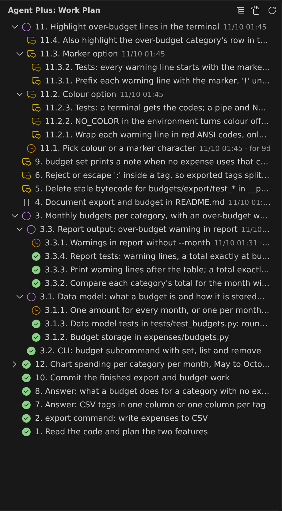
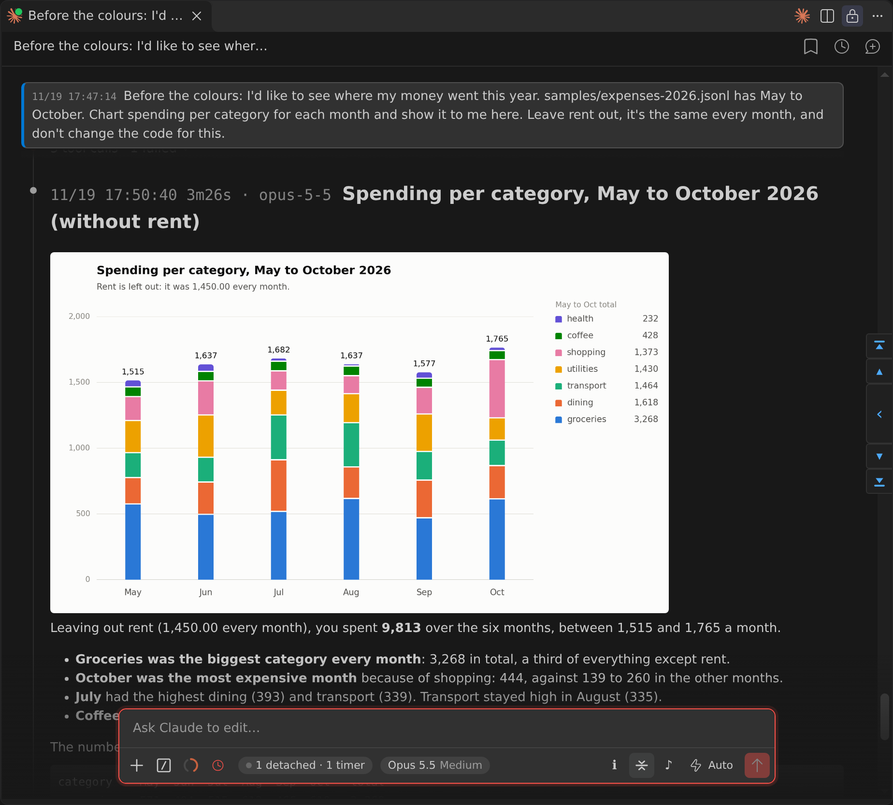
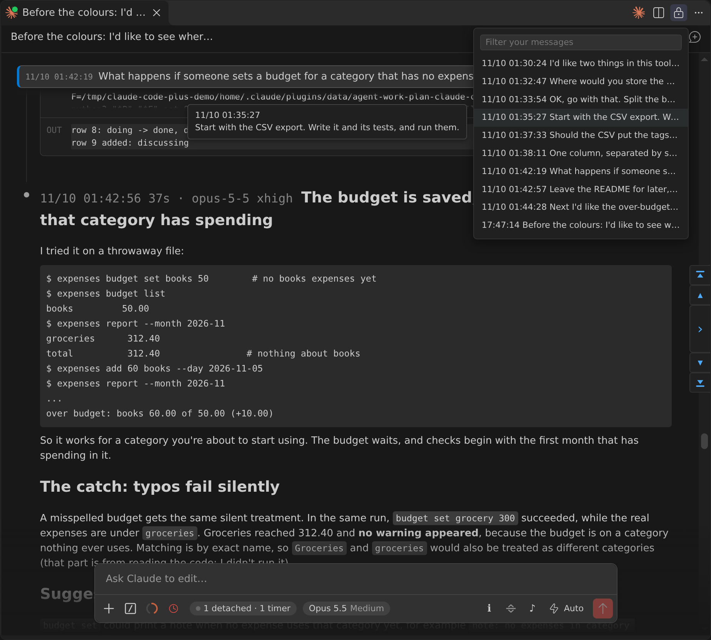
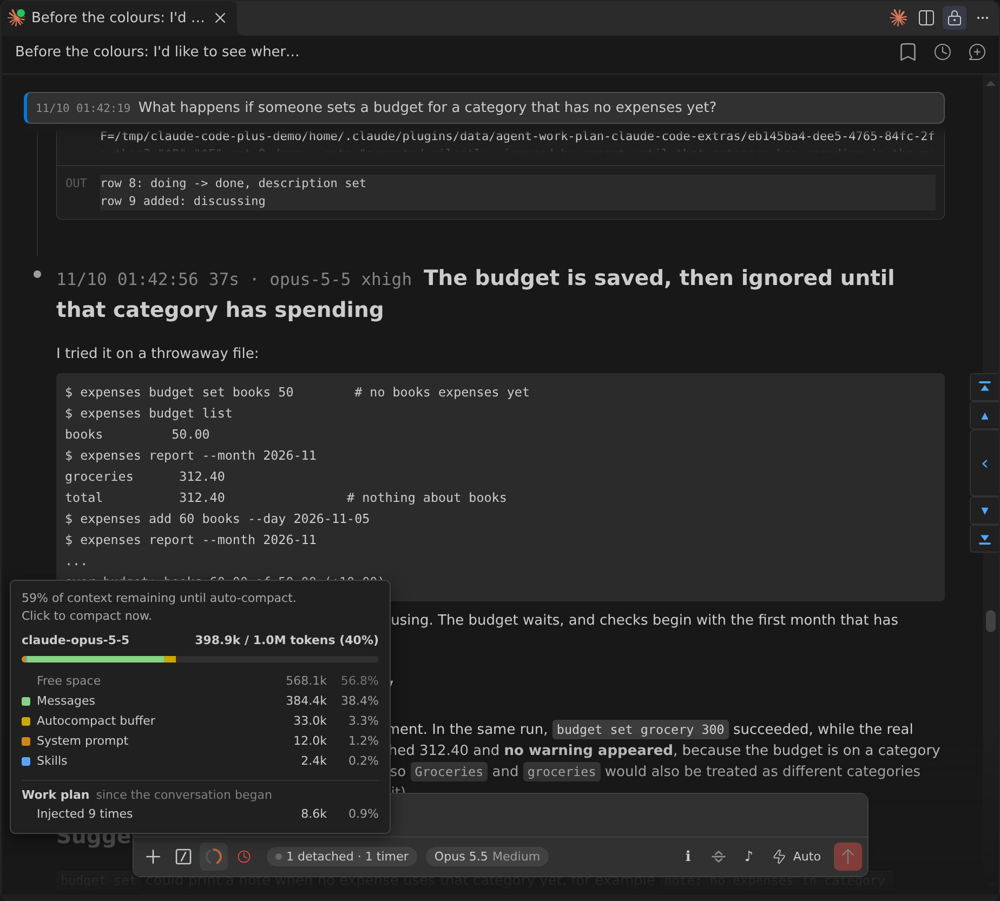
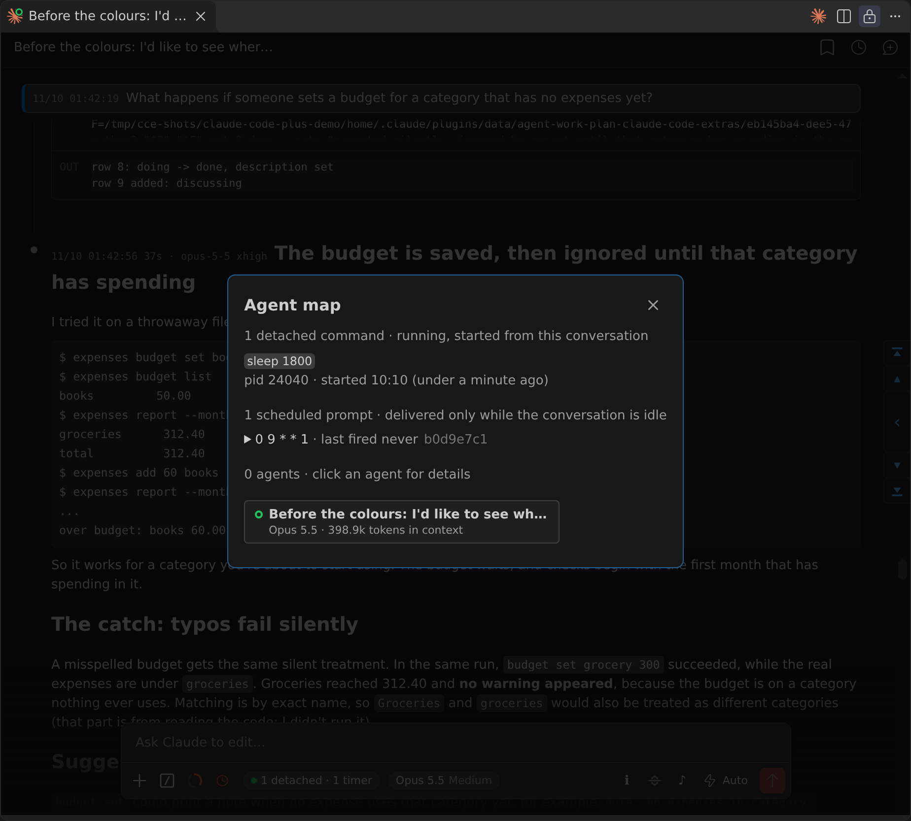

# Claude Code Plus

Claude Code Plus extends Anthropic's Claude Code extension for VS Code with a work plan that helps Claude track unfinished work when you switch topics or compaction summarizes older turns.

## Install

Requires Anthropic's Claude Code extension, Agent Plus and VS Code 1.96 or later. The work plan also needs Python 3.7 or later. On Windows without Python, the extension offers to download it from python.org (11 MB).

Search for **Claude Code Plus** in the Extensions view, or run
`code --install-extension xnervwang.claude-code-plus`. Anthropic's Claude Code extension and
Agent Plus install as dependencies.

If you have Work Plan for Claude Code (`xnervwang.claude-code-extras`), update it to its last version, which installs Claude Code Plus (`xnervwang.claude-code-plus`); you can then uninstall the old extension. While an earlier version of the old extension is installed, Claude Code Plus does nothing except show a warning when you run a command, because both extensions would patch the same Claude Code files. If you uninstall an earlier version of the old extension, VS Code runs its uninstall step on the next start: it copies plans to `~/.claude/agent-work-plan-plans-<time>/`, then unregisters the plugin. Within half a minute, Claude Code Plus registers the plugin again and copies the plans back. On its first start, Claude Code Plus copies `claudeCodeWorkPlan.*` and `claudeCodeExtras.*` settings to `claudeCodePlus.*`, except those kept in a remote machine's own settings file, which you rename by hand. Once no earlier version of the old extension is installed, Claude Code Plus copies whichever files that record your [session-list pins and title text colors](docs/features.md#in-the-session-list) are missing from its own storage folder at each start, using the copies in the old extension's storage folder. Install Claude Code Plus before uninstalling the old extension, since VS Code deletes that storage when it finishes removing the old extension at its next start.

The extension works by editing files inside the installed Claude Code extension. Reload the
VS Code window twice after installing. Run `Claude Code Plus: Show Status` for the patch
status. In a Remote SSH window, install on the remote.

Verified against Claude Code 2.1.328, 2.1.329, 2.1.330, 2.1.331 and 2.1.332.

## Features

### Work plan

Each turn, Claude gets the open rows, those not done or dropped, from the conversation's separate plan file. The rows, one for each piece of work, are numbered 1, 2, 2.1 and so on. You can refer to several rows in one message by number, as in `2.1: not now`.

In the VS Code panel, Agent Plus's Conversations tab lists running Claude Code conversations and stopped ones with open plan rows. When a plan row needs your answer, its question appears under the conversation, and what you type in the adjacent Answer view goes into that conversation's message input. [More about the work plan](docs/work-plan.md).

### In a conversation

| Feature | What it does |
| --- | --- |
| [Timestamps](docs/features.md#in-a-conversation) | Every message and reply block shows its transcript time, and tool calls show `start→result`. Claude Code's own message times are hidden while transcript times are on. |
| [Your time zone for Claude](docs/features.md#in-a-conversation) | If Claude runs on a machine in another time zone, as with Remote SSH, the extension tells Claude to use your time zone for times in its replies. |
| [Images in replies](docs/features.md#in-a-conversation) | Replies show `data:` images inline, along with images Claude gives by absolute path or `file://` address; an image at a web address stays a link. Click a scaled-down image to enlarge it as far as the panel allows. |
| [Links to other conversations](docs/features.md#in-a-conversation) | A reply links the name or session ID of any other conversation Agent Plus lists, including a Codex conversation. Hover to see its agent and when it was last active, or click to open it in the VS Code window that shows it. |
| [Plan bar](docs/features.md#in-a-conversation) | If a conversation has a work plan, the bar just above the input box shows the number of open rows, the row in progress and a yellow count of questions that need your answer. Click the bar to open the plan in Agent Plus's Work plan view, or click the question count to answer. |
| [Reply figures](docs/features.md#in-a-conversation) | Each reply shows the turn's duration, the share of the context window in use, the conversation's cost so far, the model and the effort, as in `2m10s · ctx 33% · cost $0.42 · opus-5 high`. |
| [Sub-agent tags and filters](docs/features.md#in-a-conversation) | Each sub-agent's messages carry its task as a tag, such as `#look up tomorrow's weather`. You can use the footer filter to show only the main thread or a single sub-agent. |
| [Conversation navigation](docs/features.md#in-a-conversation) | A handle on the panel's right edge opens a list of your messages by time and first words, with compaction points marked. Click a row to scroll to that message. |
| [Focus view button](docs/features.md#in-a-conversation) | You can turn Claude Code's Focus view on or off with a footer button, which also folds up any tool calls you opened. During a turn in Focus view, the working line shows the latest tool call and how long it has run. |
| [Context meter](docs/features.md#in-a-conversation) | The panel's context meter stays visible and gains an outline when 15% of the context window remains. Hover for two seconds to see how much context the work plan adds and how context use breaks down by category, by memory file and by custom agent. |
| [Chimes](docs/features.md#in-a-conversation) | A short sound plays on the computer where you view the panel when a turn ends or Claude asks for permission or an answer. You can mute the sound in the footer. |
| [Session information](docs/features.md#in-a-conversation) | A footer button shows the session ID, Claude's process ID, the starting directory, the transcript's location and size, and the [token mode](docs/token-costs.md#token-modes). Click a value to copy it. |
| [A title of its own](docs/features.md#in-a-conversation) | Ask Claude to rename its conversation, and it runs the work plan plugin's `retitle.py`; the window showing the conversation sets the new title. Not in Interface features token mode, which skips the plugin. |
| [Token mode](docs/token-costs.md#token-modes) | You choose a token mode from Agent Plus's status bar entry: Interface features, Essential features, All features (the default) or Custom. Your choice decides which of the work plan, the time-zone note, the conversation brief (its summary and where it stands) and the notices sent when a [detached command](#background-work) stops go into Claude's context. |

### In the session list

| Feature | What it does |
| --- | --- |
| [Agent Plus's session list](docs/features.md#in-the-session-list) | Agent Plus's session list in the side bar shows the Claude Code conversations of the folder open in this window alongside conversations from other agents; you can open, rename, archive, group, pin and delete Claude Code conversations there. |
| [Where else a conversation is open](docs/features.md#in-the-session-list) | If a conversation is open in a terminal, a `claude --bg` job or Claude Desktop, its row is dimmed; hover over the row to see where it is open. |
| [The figures of the conversation in front](docs/features.md#in-the-session-list) | Account & usage, at the top of Agent Plus's session list, shows estimated cost, API time, time since the conversation started and lines changed for the Claude Code conversation in this window's active editor tab or sidebar. |
| [Kept from Claude Code's cleanup](docs/features.md#in-the-session-list) | This extension keeps Claude Code's automatic transcript cleanup from deleting conversations that Agent Plus's session list still keeps. |
| [Claude Code's own list hidden](docs/features.md#in-the-session-list) | Turn on `claudeCodePlus.hideOfficialSessionList` to take Claude Code's own session list out of the Activity Bar. |
| [Background sessions left out](docs/features.md#in-the-session-list) | Claude Code's own list skips sessions started with `claude --bg` or `claude -p` (see [Background work](#background-work)), and empty transcripts. |
| [Not in Agent Plus's list](docs/features.md#in-the-session-list) | Claude Code's Web tab and the claude.ai subscription bars, which need a claude.ai sign-in, are only in Claude Code's own list. |

### On editor tabs

| Feature | What it does |
| --- | --- |
| [Status dots](docs/features.md#on-editor-tabs) | A dot at the top right of a Claude Code tab's logo is solid green while a turn runs, a green ring when only [background work](#background-work) is running, and red when the conversation waits for you. Session list rows and the [Supervisor panel](#supervisor) show the same dots. |
| [Notices of waits](docs/features.md#on-editor-tabs) | Agent Plus notifies you in your current VS Code window when a conversation outside it is waiting for tool permission, an answer to a question, a review of the plan it made in plan mode or your choice of Continue or Stop in auto mode. Click Open to go to that conversation's window. |
| [Unread envelope](docs/features.md#on-editor-tabs) | When a conversation has a reply you have not seen, an envelope (✉️) appears at the end of its tab title and after its title in both the Supervisor panel and Agent Plus's session list. The envelope disappears when the conversation is shown. |
| [Tabs back after a restart](docs/features.md#on-editor-tabs) | When the window starts, Claude Code Plus reopens Claude Code tabs that were open when it closed but that VS Code did not restore, as can happen after a lost remote connection. Tabs you closed while connected stay closed. |
| [Load background tabs](docs/features.md#on-editor-tabs) | Turn on `claudeCodePlus.loadRestoredTabs` to load Claude Code conversations in background tabs when the window starts. By default, they load when you first click them. |

### Background work

| Feature | What it does |
| --- | --- |
| [Agent map](docs/features.md#background-work) | The Agents button in the footer of Claude Code's panel opens the agent map. The conversation's row comes first, followed by sections for Claude Code's subagents and background tasks, then detached commands, scheduled prompts, `claude -p` sessions and `claude --bg` sessions. |
| [Detached commands](docs/features.md#background-work) | On Linux, the agent map shows each command the conversation left running outside Claude Code, with its PID, start time and how long it has been running. Hover over a command to see its full command line. |
| [Background sessions](docs/features.md#background-work) | The agent map shows each of the conversation's `claude --bg` sessions and its state. Click a session to see what it waits for and its result, along with the commands to attach to it and read its logs. |
| [Scheduled prompts](docs/features.md#background-work) | The agent map lists timers the conversation set through Claude Code's scheduled tasks, with the first line of each prompt as its title, its schedule and the time it last fired. Click a timer to see the full prompt. |
| [Background commands](docs/features.md#background-work) | While a background build, test run or `sleep` timer runs, the footer shows a count such as `1 task`. Click the count to see the list. |
| [Workers](docs/features.md#background-work) | The agent map shows the `claude -p` workers the conversation started that are still running, with each worker's name, PID, start time and how long it has been running. |
| [Agents button dot](docs/features.md#background-work) | A green dot on the Agents button means background work from this conversation is running. The dot turns grey when all that work ends. |
| [Background session notices](docs/features.md#background-work) | The conversation gets a result or error when a `claude --bg` session it started finishes, fails, is stopped or dies. If the session is waiting for an answer, the conversation gets its question. An idle conversation starts a turn when the notice arrives. |

### Supervisor

Tick other Claude Code conversations or OpenCode Agent Plus conversations in the Supervisor panel to make the current Claude Code conversation their supervisor; it gets notified when one needs you or stops and relays that conversation's questions word for word.

Start a message to the supervisor with `@` and a conversation's name, or ask it to message one; the supervisor writes the message and Claude Code Plus sends it there. For an OpenCode Agent Plus conversation, Claude Code Plus passes the message to Agent Plus, which sends it to the conversation. A conversation can have several supervisors, and in a supervisor's own conversation you can ask it to start or stop managing another conversation. [More about the supervisor](docs/steward.md).

## What it costs in tokens

Claude Code Plus adds text such as the work plan and reminders to what Claude Code sends the model; drawing the interface sends nothing to the model. For each addition, you can check [when Claude Code Plus sends it, how large it can be and which setting turns it off](docs/token-costs.md).

## Settings and commands

Run `Claude Code Plus: Settings` to open all of this extension's settings. Use [Settings and commands](docs/settings.md) to find the work plan settings, learn how to turn off each addition or look up an extension command.

## Known limits

[Known limits](docs/known-limits.md) covers the work plan, the supervisor and how Claude Code Plus patches Claude Code's files. It also covers what happens when a window loses its remote connection.

## Contributing

See [CONTRIBUTING.md](CONTRIBUTING.md) for the layout, checks, and verified-build records.

## License

BSD 3-Clause.
