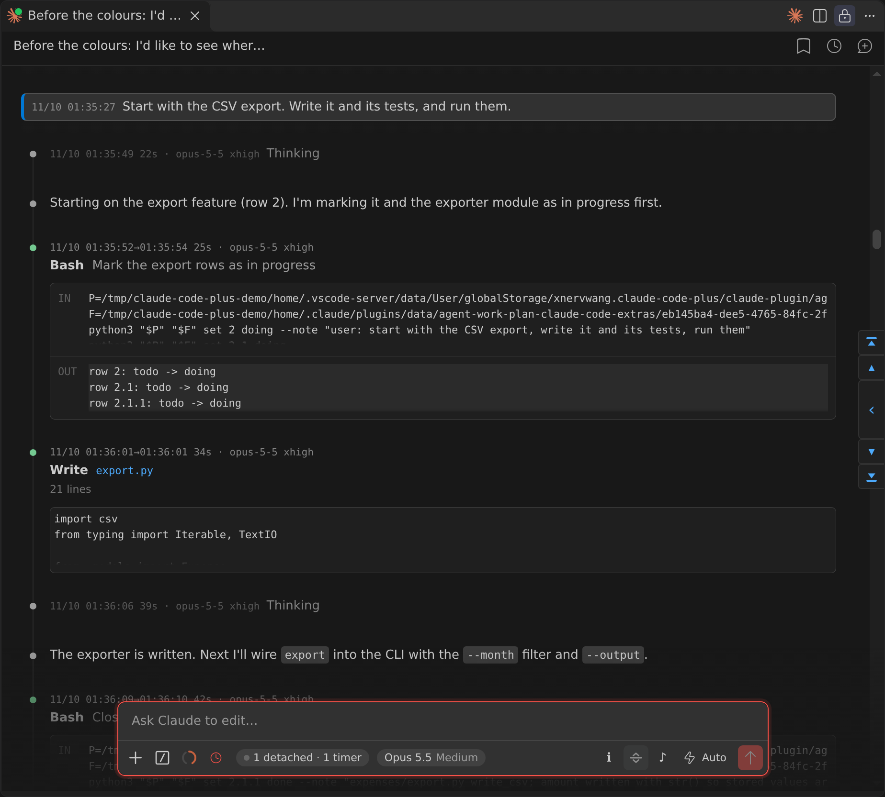
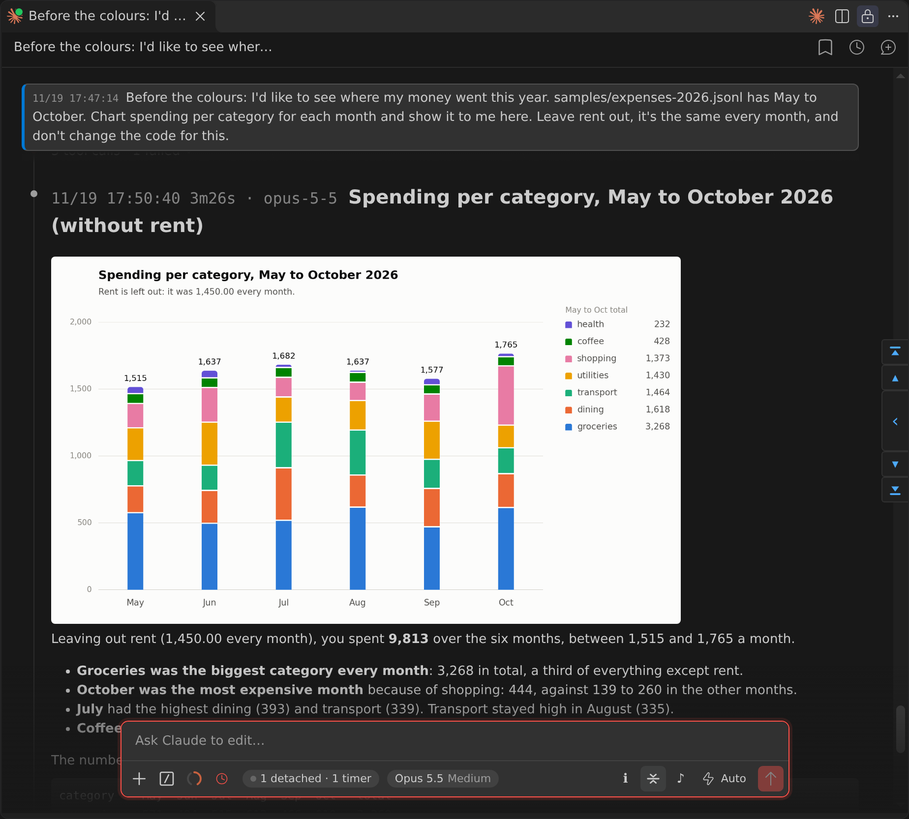
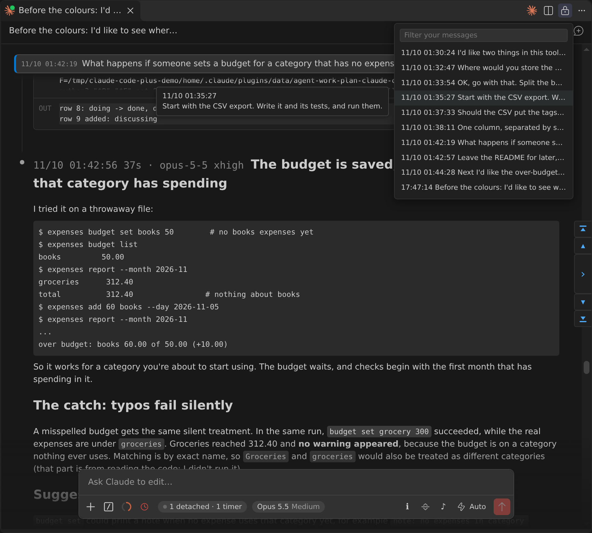
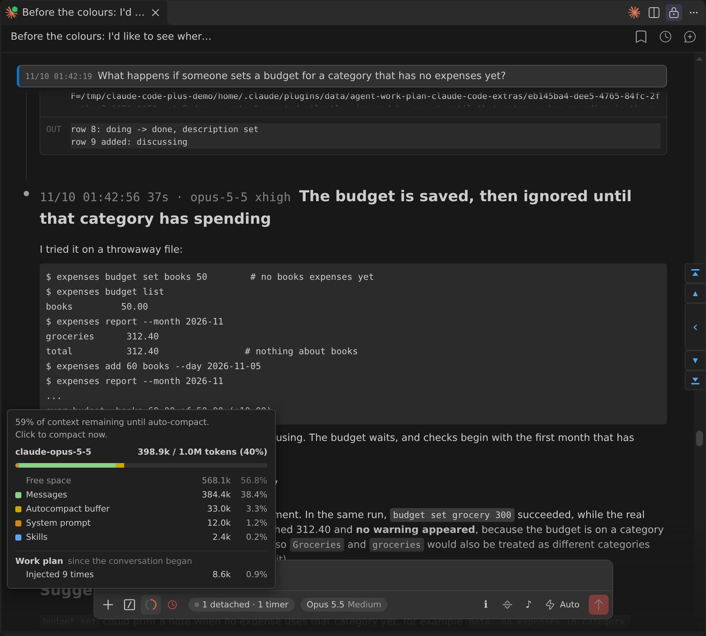
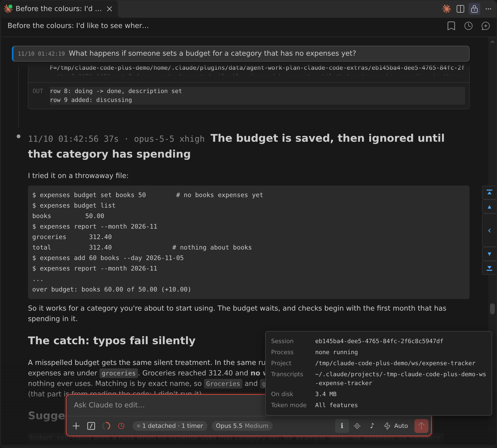
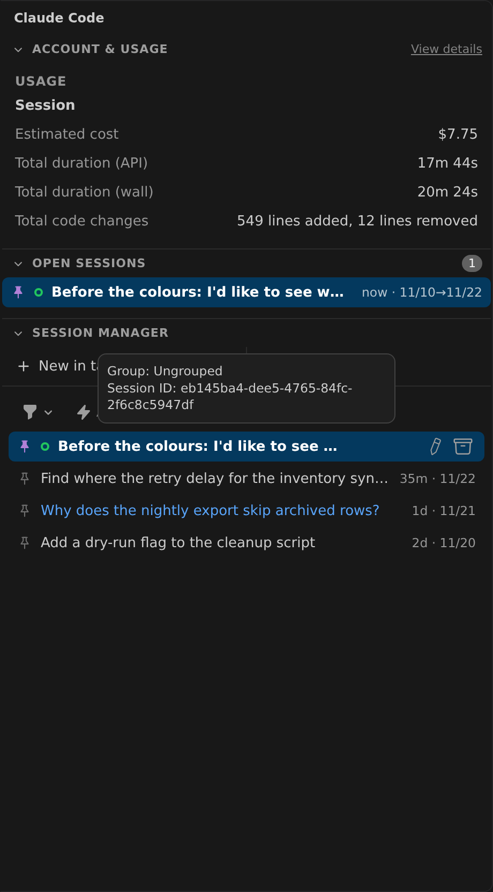
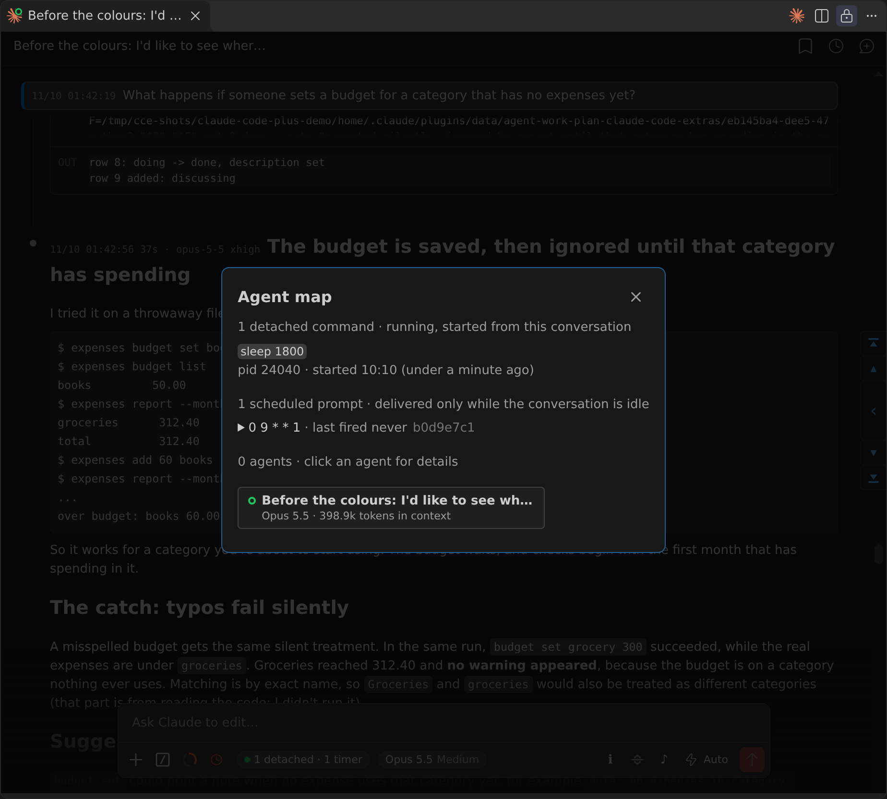

# Other features

Back to the [README](../README.md).

## In a conversation

| Feature | What it shows |
| --- | --- |
| Timestamps | Times from the transcript on every message and reply block, and `start→result` on tool calls. Claude Code's own message times are hidden while these are on. |
| Your time zone for Claude | When Claude runs on a machine in another time zone, as with Remote SSH, it is told yours, so it gives you times in your zone. |
| Images in replies | An image Claude gives by absolute path or `file://` address (PNG, JPEG, GIF, WebP or SVG, up to 8 MB) and a `data:` image are drawn in the reply, at most 640 by 480 pixels; click one drawn smaller than its own size to see it as large as the panel allows. An image at a web address stays a link. Claude is told how to give one: save it in the conversation's own folder, and download an image from the web there first. `claudeCodePlus.show.replyImages` turns both off. |
| Links to other conversations | Another conversation's name or session ID in a reply becomes a link, drawn like Claude Code's own; click it to open that conversation in the VS Code window that shows it. Inside corner brackets (「name」), a name needs at least 4 characters or at least 2 Chinese, Japanese or Korean characters. A name on its own must be at least 10 characters wide, with each Chinese, Japanese or Korean character counting as 2. These minimums keep short titles from matching ordinary words. Either the full session ID or its first 8 characters can become a link. Session IDs in file paths are skipped. Hovering over a link shows the conversation's agent, when it was last active, and any other conversation with the same name. Links can open any conversation Agent Plus lists, across all its agents, including Codex. These are the conversations running on the machine where Claude Code runs, and those the Conversations view shows in the current window. `claudeCodePlus.show.conversationLinks` turns it off. |
| Plan bar | When a conversation has a work plan, a bar directly above the input box spans its width. From left to right, the bar shows "Plan", a short color track, the open row count (`8 open`), then the current row's [number](work-plan.md#row-numbers) (`2.1.1`), state mark and title, and an arrow at the end. When questions in the plan wait for your answer, a count such as `2 to decide` appears between the title and the arrow. Each track segment spans its share of the open rows: blue for doing, orange for waiting, yellow for discussing, purple for to do and grey for parked. Of the rows in the doing state, the most deeply nested is current, with plan order breaking ties in favor of the first. If none are doing, the bar leaves the space for the current row empty. Closing the last open row changes the display to a green check and `All rows done`. The bar keeps the same size as the plan changes; a long title ends in an ellipsis. Hover to see up to 30 open rows. If there is a current row, its full title appears first. Click the bar to see this conversation's plan in Agent Plus's Work plan view. The `to decide` count includes only questions waiting for your answer in this conversation. Its background and the dot before it use VS Code's status bar warning yellow (`statusBarItem.warningBackground`), the same color as Agent Plus's `N conversations need you` status bar entry. Clicking the `to decide` count opens Agent Plus's Answer view at the first waiting question. In a panel narrower than 400 pixels, the bar shows only the number of open rows and the number of waiting questions. `claudeCodePlus.show.planBar` turns it off. |
| Reply figures | `2m10s · ctx 33% · cost $0.42 · opus-5 high` on each reply shows turn duration, how much of the context window is in use, the conversation's cost so far, model and effort. |
| Sub-agent tags and filters | Each sub-agent's messages are tagged with its task, such as `#look up tomorrow's weather`. A filter in the footer shows only the main thread or one sub-agent. |
| Conversation navigation | A handle at the right edge of the panel opens a list of your messages by time and first words, with the compaction points marked. Filter the list, click a row to scroll there, step with the arrows or `,` and `.`, or jump to the top or bottom. |
| Focus view button | A footer button that turns Claude Code's own Focus view on and off. If you open a tool call that Focus view folded, the button's arrows point away from the line in the middle of its icon, as they do with Focus view off, and a click folds the calls you opened again while Focus view stays on. While Focus view is on and Claude works, the working line shows the latest tool call and how long it has run, such as `Bash running for 2m55s (since 11:11:18)`. |
| Context meter | The panel's context meter stays visible and gets an outline when 15% of the window remains. Rest the pointer on it for two seconds for a breakdown by category, memory files and custom agents, with what the work plan has added to the context. |
| Chimes | A short sound when a turn finishes, permission is requested or Claude asks a question, played on the machine showing the panel. Mute it in the footer. |
| Session information | A footer button that shows the session ID, Claude's process ID, starting directory, transcript location and size, and the token mode. Click a value to copy it. |
| Token mode | Agent Plus's `agentPlus.tokenMode`, set from its entry in the status bar, decides which of the work plan, the time-zone note, the conversation brief (a summary, and a status saying where the conversation stands; see [Settings](settings.md#settings)) and the detached-command notices are added to Claude's context. Each one's own setting applies only in Custom. See [What it costs in tokens](token-costs.md). |

## In the session list

| Feature | What it shows |
| --- | --- |
| Open sessions | A section near the top of Claude Code's session list shows the conversations open in this window, in an editor tab or in the sidebar while it is shown, most recently active first. Each row shows its status dot and, while a reply is unread, an envelope; click the row to switch to the conversation. |
| Open in a tab or the sidebar | **New in tab** and **New in sidebar** replace the New session button. |
| Section and session ID on hover | Hovering over a conversation shows its session ID and where it sits in the list below Open sessions: its group, Ungrouped or Archived sessions. Rows in Open sessions show the same. |
| Search by session ID | The search box also finds a conversation by part of its session ID, such as `69f9`: four or more characters, using only 0-9, a-f and hyphens. Shorter searches, and ones with other characters, match titles and branches only. |
| RECENTLY CLOSED | A section directly above Open sessions with the conversations whose Claude Code editor tabs you closed in this workspace, most recently closed first. Click one to open it again. |
| Session dates | Adds the dates of the first and last messages after Claude Code's last-active time: `11d` becomes `11d · 09/05→09/16`. |
| Pinned conversations | Click the pin at the start of a session-list row to keep that conversation from Claude Code's transcript cleanup (`cleanupPeriodDays`) and out of Archived sessions. |
| Text colors | Right-click a conversation and choose **Text color** to give its title one of the colors of Claude Code's `/color`. The color shows wherever the conversation is listed. |
| Delete archived conversations | **Delete session…** in an archived conversation's right-click menu permanently deletes it from disk once you confirm. You cannot delete a conversation that is running or open in any VS Code window on the same machine. This includes a tab that VS Code restored after a window reload but has not yet loaded. Claude Code Plus then names the window that has it open. |
| Background sessions left out | The list skips sessions started with `claude --bg` or `claude -p`, and empty transcripts. Turn off `claudeCodePlus.hideBackgroundSessions` to see them, including the `claude -p` sessions that Claude Code's own list leaves out. Claude Code's daemon sessions stay hidden either way. |

### Opening in a tab or the sidebar

A closed conversation's right-click menu offers **Resume in tab** and **Resume in sidebar** instead of Resume session; an open one keeps Switch to session. These do not change `claudeCode.preferredLocation`; the Claude button at the right of the editor tabs still opens where that setting says.

### Recently closed

The section starts collapsed, and the list is kept across reloads. Open conversations are not listed, and up to `claudeCodePlus.recentClosedSessions` conversations are shown (10 by default).

### Pinned conversations

To protect a pinned conversation, the extension moves its files' modification time forward once they are old enough for the cleanup. The row still shows when the conversation was last active, but the list sorts it by the moved time. Uninstalling the extension removes the pins; the conversations stay, and the cleanup treats them as usual again.

Pins are kept on the machine that holds the transcripts. A pin protects a conversation only while some VS Code window with this extension connects to the machine that holds its transcript, and stays open for at least a minute, at least once every `claudeCodePlus.sessionPinsMarginDays` days (14 by default, and never more than half of `cleanupPeriodDays`). The folder the window has open does not matter: each window refreshes every pinned conversation on that machine a minute after it starts and every 30 minutes while it stays open. After a longer gap, Claude Code's cleanup can delete pinned conversations the next time Claude Code runs on that machine, in a terminal or as a background session.

### Deleting archived conversations

Deleting an archived conversation removes its transcripts, sub-agent conversations, saved tool outputs, file checkpoints (Claude Code's copies, not your files), debug log and work plan. A conversation open in a tab or the sidebar, or still running, is left alone.

## On editor tabs

| Feature | What it shows |
| --- | --- |
| Status dots | The dot is at the top right of a Claude Code tab's logo. A solid green dot means a turn is running. When the turn has ended and only background work is still running, the dot becomes a green ring; see [Work that shows a green ring](#work-that-shows-a-green-ring). The dot is red if the conversation is waiting for you at a permission prompt or a choice. It is also red if the conversation has asked you a new question in its work plan since your last message. There is no dot when the conversation has stopped and nothing is running. The session list rows and the Steward panel show the same dots. Claude Code itself shows no dot while a turn runs. A blue dot means it is waiting for permission. An orange one marks an unread reply. Claude Code Plus does not use blue and shows an unread reply with an envelope instead. |
| Notices of waits | Agent Plus notifies you in your current VS Code window only when a conversation outside it needs your input. The conversation may ask for permission to use a tool, ask you a question, have a plan for you to review or wait for you to choose Continue or Stop in auto mode. For permission requests, the notice names the tool. Click Open to go to the conversation's own window. Claude Code normally shows its notice for that wait only in the conversation's window. While Agent Plus shows its notice, Claude Code skips its own. Claude Code shows its own notice again if either `agentPlus.notifications.enabled` or `agentPlus.notifications.waiting` is off, if VS Code is in Restricted Mode, or if your version of Agent Plus is too old to report what the conversation is waiting for. Claude Code's other notices are untouched. |
| Unread envelope | While a conversation has a reply you have not seen, its tab title ends with an envelope: ✉️. In the session list and the Steward panel, the envelope comes after the title and before the time, and a long title is cut short with an ellipsis before the envelope to keep it visible. In a light theme, the envelope uses its one-color text form (✉︎) because a color emoji font draws it white. The envelope disappears when the conversation is shown. It is independent of the dot: a green dot with an envelope means the conversation has replied and is still working. Claude Code Plus sets Claude Code's own unread mark if a turn ends while the conversation is off screen and background work is still running, though Claude Code itself marks a reply unread only when nothing is left running. The envelope is only drawn, so it never appears in the stored title or the rename box. |
| Tabs back after a restart | Claude Code tabs that were open when the window closed but that VS Code did not restore, as can happen after the window lost its remote connection, are opened again when it starts. Tabs you closed while connected stay closed. |
| Load background tabs | Off by default. With `claudeCodePlus.loadRestoredTabs` on, Claude Code conversations in background tabs load when the window starts, instead of when you first click them: each tab comes to the front for a moment, then the one you had in front comes back. |

### Work that shows a green ring

A conversation shows a green ring after its turn ends if it leaves work running. That includes a `claude --bg` session or `claude -p` worker it started. On Linux, Claude Code Plus also checks `/proc` for commands the conversation left running outside Claude Code. A shell or `timeout` counts as long as it outlives the command that started it, as can happen with `setsid` or `nohup`. Any other program started with `setsid` counts because it leads its own session. For example, `setsid nohup bash -c 'python3 job.py'` leaves `python3` itself as the session leader. Programs that detach without starting their own session do not count, including servers a build leaves running this way. Use the Agents button in the footer of Claude Code's panel to open the agent map. It lists each of these commands with its PID and start time. Hover over a command to see its command line. In All features token mode, Claude Code Plus notifies the conversation that started the command when it stops, but cannot report its exit code. Custom mode sends the same notices while `claudeCodePlus.detachedEndNotices` is on.

Claude Code runs background commands, subagents, monitors and workflows in the conversation's own process. Starting in version 2.1.326, Claude Code reports this work to the work plan plugin at the end of each turn. With the plugin loaded, this work shows the green ring on every platform. Interface features token mode skips the plugin. Without the plugin or on Claude Code versions before 2.1.326, only background commands can show the green ring. That works only on Linux, where Claude Code Plus finds them through `/proc`. Reloading the window ends the work in the conversation's process, and the ring disappears.

## Background work

| Feature | What it shows |
| --- | --- |
| Agent map layout | The map shows the conversation's own row first, under THIS CONVERSATION, then a section for each kind of work: Claude Code's subagents and background tasks, then detached commands, scheduled prompts, `claude -p` sessions and `claude --bg` sessions. Only sections with entries appear. Each has a heading that shows its count, with a thin line above it. Claude Code's own two headings get the same look, with their "click ... for details" as hover text. Every row Claude Code Plus adds is a card like Claude Code's: a dot, a title and one line under it. |
| Detached commands | On Linux, the agent map lists the commands this conversation left running outside Claude Code. This includes commands left running by a `claude -p` worker the conversation started, even after the worker ends. Each such command's card shows "by worker" followed by the first 8 characters of the worker's session ID. Each card's title shows the program and the argument that identifies what it runs. The card shows the PID, start time and how long the command has been running. Hover over it to see the full command line. The Agents button counts them, as in `1 detached`. |
| Background sessions | The agent map, opened from the Agents button in the footer, lists this conversation's `claude --bg` sessions. Each card shows the session's state under its name and uses the same dot Claude Code uses for an agent in that state. Clicking one shows what it waits for, its result, and the attach and logs commands. |
| Scheduled prompts | The agent map also lists the timers this conversation set through Claude Code's scheduled tasks, each titled by the first line of its prompt, with its schedule and last-fired time. Click a scheduled prompt's card to read the whole prompt. |
| Background commands | The footer shows a count such as `1 task` while a background build, test run or `sleep` timer runs, with the list one click away. |
| Workers | The agent map lists the `claude -p` workers this conversation started that are still running. For each worker, it shows the name, PID, start time and how long it has been running, with its session ID and state as hover text. With one worker running, the Agents button reads `1 worker`. On Linux, Claude Code Plus finds a worker even if its session ID was never printed, by reading the session record of the `claude` process under a command the conversation left running. That command is then left out of the detached commands. On other systems, a worker shows only if the command that started it printed its session ID. |
| Agents button dot | The Agents button in Claude Code's panel footer opens the agent map. Its dot is green while any background work from this conversation is running: background commands and monitors, subagents and workflows in the background, detached commands, and the `claude --bg` sessions and `claude -p` workers it started. The dot turns grey when all that work ends. A scheduled prompt alone does not turn it green. In the map, the conversation's own row has the same dot as its tab: green while a turn runs, a green ring when only background work runs, and red while the conversation waits for you. |
| Background session notices | When a `claude --bg` session this conversation started finishes, fails, is stopped, dies, or waits for an answer, the conversation is told, with the session's result, error or question, and an idle conversation starts a turn. A session the conversation stopped itself is not reported. In All features token mode, or in Custom while `claudeCodePlus.detachedEndNotices` is on. Not on native Windows: the notice goes to the conversation's inbox socket, as a steward's does (see [Known limits](known-limits.md#steward)). |

