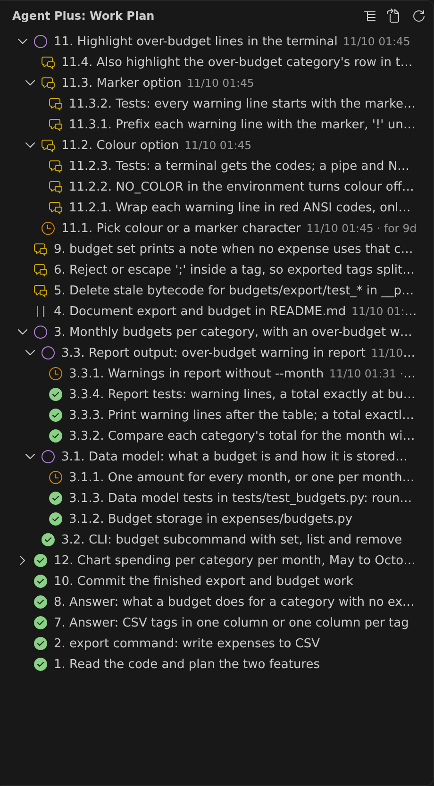

# Work plan

Back to the [README](../README.md).

Claude Code Plus gives Claude a work plan, so that Claude does not lose track of unfinished work when you switch topics before the work is done, or when compaction summarizes older turns. Claude starts a plan when there is work to track and updates it as you talk. Each piece of work is a numbered row in the plan.

The plan is stored in a file outside the conversation, and Claude gets its open rows every turn. Agent Plus, a separate extension installed along with this one, shows the plan in a view beside the Claude Code panel.

Agent Plus's Conversations tab in the VS Code panel lists running Claude Code conversations in this window's workspace folders. Stopped conversations also appear if their plan still has open rows and was written in the last 7 days. A row that waits for your answer carries a question; the question appears under its conversation, and an answer entered in the Answer view next to the Conversations tab goes into that conversation's message input.

Claude starts a plan when you bring up work it should track, or when you ask for one.

If a conversation runs long without a plan, Claude gets a one-time suggestion to start one (see [Settings](settings.md#settings) for what counts as long).

## Row numbers

Rows have numbers such as 1, 2 and 2.1. You can answer several rows in one message, in any order:

```text
2.1: not now
3: go ahead
```

A row's number is its position in the plan file, so it does not change: finishing row 2 leaves a gap instead of renumbering the rows after it. A child row such as 2.1 is work that has to be done before its parent can be finished.

## States

| State | Meaning |
| --- | --- |
| `discussing` | Raised, not agreed yet. |
| `todo` | Agreed, not started. |
| `doing` | Being worked on now. |
| `waiting` | Started, but held up by something outside the conversation, such as you, a build or CI run, a reviewer or another conversation. |
| `parked` | Left for later, with the reason; still open. |
| `done` | Finished. |
| `dropped` | Decided against, with the reason. |

Work you ask Claude to do now goes straight to `doing`. Work Claude suggests on its own starts as `discussing` and becomes `todo` only when you agree.



## How Claude gets the plan

The extension registers a Claude Code plugin whose hooks hand the plan to Claude on each turn and around compactions. Its skill holds the rules Claude follows to keep the plan up to date.

- The plugin's skill description loads in every session at about 110 tokens.
- With a plan, every turn carries its open rows: the whole block, with the instructions, on the first turn and the first after each compaction; a short head (the open rows under a shorter header instead of the instructions) when a row has changed; one line when none has. Rows that are `doing` and questions to you carry their notes; other rows show their title only. A finished row can be included when a row under it is still open. The block is cut to fit 6,000 characters, and a last line says how many open rows were left out. See [What it costs in tokens](token-costs.md).
- Before an automatic compaction, Claude is asked to bring the rows it is working on up to date. After compaction, it is asked to read the plan file before anything else.

## Where the plan lives

Each conversation has one file, named by session ID, under `~/.claude/plugins/data/agent-work-plan-claude-code-extras/`.

Claude writes the file through a small command shipped with the plugin. To correct a plan by hand, open its file from the view's title-bar button or a row's context menu.

See [How the work plan works](how-the-work-plan-works.md) for the hooks, thresholds and measurements.
